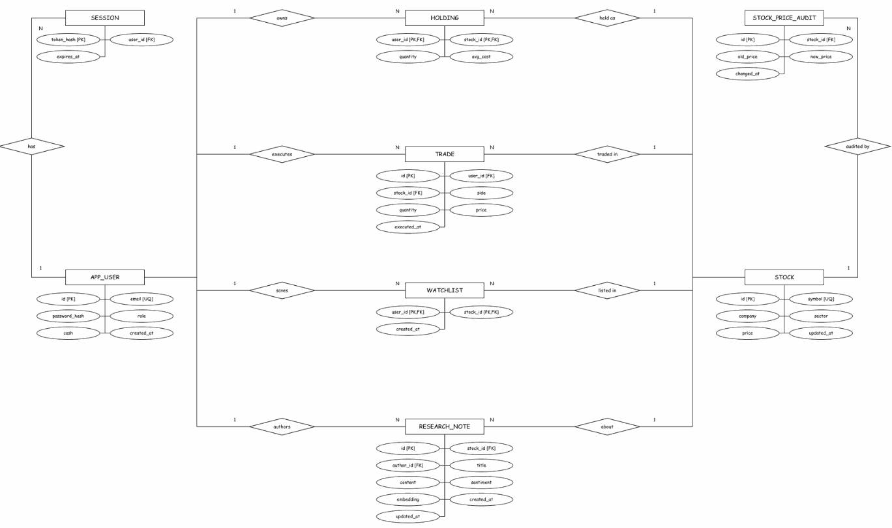

# StockLens Mini Project Evaluation & Demo Deliverables

**Course:** Database Management Systems (UE24CS351A) · Section C  
**Project:** StockLens — Paper Market Intelligence & Trading Lab  
**Team Members:**  
- **Debaditya Chakrabarti** (`PES1UG24CS140`) — Part 1: Investor Core & Relational Trading  
- **Dhadhal Rudra** (`PES1UG24CS146`) — Part 2: Vector Intelligence, Admin Controls & Audit Triggers  

This document provides a line-by-line guide demonstrating all **14 Mini Project Demo Deliverables** directly in the GitHub repository.

---

## 1. ER Diagram

The complete system Entity-Relationship diagram models 8 entities across both relational trading and vector intelligence paradigms:



Rectangles represent entities, diamonds represent relationships, and ovals represent attributes. **1** means exactly one parent; **N** means zero or many related records. **PK** = primary key, **FK** = foreign key, and **UQ** = unique. HOLDING and WATCHLIST have composite primary keys `(user_id, stock_id)`.

- **File Reference:** Also documented in [`docs/RESEARCH_ADMIN_DESIGN.md`](RESEARCH_ADMIN_DESIGN.md#3-complete-system-er-diagram) and [`docs/INVESTOR_DESIGN.md`](INVESTOR_DESIGN.md#er-diagram).

---

## 2. Relational Schema with Keys, Relationships, and Constraints

| Table | Primary Key | Foreign Keys | Key Constraints & Checks |
|---|---|---|---|
| `app_user` | `id` (BIGSERIAL) | None | `UNIQUE(email)`, `email = lower(email)`, `length(email) BETWEEN 3 AND 254`, `role IN ('investor','admin')`, `cash >= 0` |
| `session` | `token_hash` (TEXT) | `user_id -> app_user(id) ON DELETE CASCADE` | `expires_at TIMESTAMPTZ NOT NULL` |
| `stock` | `id` (BIGSERIAL) | None | `UNIQUE(symbol)`, regex check `symbol ~ '^[A-Z0-9]{1,12}$'`, `price > 0` |
| `holding` | `(user_id, stock_id)` | `user_id -> app_user(id) ON DELETE CASCADE`, `stock_id -> stock(id)` | Composite PK, `quantity >= 0`, `avg_cost >= 0` |
| `trade` | `id` (BIGSERIAL) | `user_id -> app_user(id)`, `stock_id -> stock(id)` | `side IN ('BUY','SELL')`, `quantity > 0`, `price > 0` |
| `watchlist` | `(user_id, stock_id)` | `user_id -> app_user(id) ON DELETE CASCADE`, `stock_id -> stock(id) ON DELETE CASCADE` | Composite PK, `created_at NOT NULL` |
| `stock_price_audit` | `id` (BIGSERIAL) | `stock_id -> stock(id) ON DELETE CASCADE` | `old_price > 0`, `new_price > 0` |
| `research_note` | `id` (BIGSERIAL) | `stock_id -> stock(id) ON DELETE CASCADE`, `author_id -> app_user(id) ON DELETE CASCADE` | `length(trim(title)) BETWEEN 3 AND 120`, `length(trim(content)) BETWEEN 10 AND 5000`, `sentiment IN ('BULLISH','BEARISH','NEUTRAL')` |

---

## 3. SQL Database Implementation – DDL with Constraints

The DDL statements are located in [`sql/schema.sql`](../sql/schema.sql):
- **Domain Constraints:** `CHECK (cash >= 0)`, `CHECK (price > 0)`, `CHECK (quantity >= 0)`.
- **String Integrity:** `CHECK (email = lower(email))`, `CHECK (symbol ~ '^[A-Z0-9]{1,12}$')`.
- **Enumerations:** `CHECK (role IN ('investor','admin'))`, `CHECK (side IN ('BUY','SELL'))`, `CHECK (sentiment IN ('BULLISH','BEARISH','NEUTRAL'))`.
- **Referential Integrity:** `ON DELETE CASCADE` ensures child sessions, holdings, watchlists, audit records, and research notes are cleanly purged when a parent user or stock is removed.
- **Indexes:**
  - `idx_trade_user_time ON trade(user_id, executed_at DESC)`
  - `idx_session_expiry ON session(expires_at)`
  - `idx_audit_stock_time ON stock_price_audit(stock_id, changed_at DESC)`
  - `idx_research_stock ON research_note(stock_id)`
  - `idx_research_author ON research_note(author_id)`
  - `idx_research_embedding ON research_note USING hnsw (embedding vector_cosine_ops)`

---

## 4. NoSQL / Vector Database Creation

StockLens utilizes the **PostgreSQL pgvector extension** to satisfy the second database paradigm:
1. **Extension Creation:**
   ```sql
   CREATE EXTENSION IF NOT EXISTS vector;
   ```
2. **Vector Table Creation:**
   ```sql
   CREATE TABLE IF NOT EXISTS research_note (
     id BIGSERIAL PRIMARY KEY,
     stock_id BIGINT NOT NULL REFERENCES stock(id) ON DELETE CASCADE,
     author_id BIGINT NOT NULL REFERENCES app_user(id) ON DELETE CASCADE,
     title TEXT NOT NULL CHECK(length(trim(title)) BETWEEN 3 AND 120),
     content TEXT NOT NULL CHECK(length(trim(content)) BETWEEN 10 AND 5000),
     sentiment TEXT NOT NULL CHECK(sentiment IN ('BULLISH','BEARISH','NEUTRAL')),
     embedding vector(64) NOT NULL,
     created_at TIMESTAMPTZ NOT NULL DEFAULT now(),
     updated_at TIMESTAMPTZ NOT NULL DEFAULT now()
   );
   ```
3. **HNSW Vector Indexing:**
   ```sql
   CREATE INDEX IF NOT EXISTS idx_research_embedding
   ON research_note USING hnsw (embedding vector_cosine_ops);
   ```
- **File Reference:** [`sql/schema.sql`](../sql/schema.sql#L1-L47).

---

## 5. Technology Justification

1. **Why PostgreSQL for Relational Core:**
   - Financial ledger balances require strict **ACID transactions**. PostgreSQL provides explicit row-level locking (`SELECT ... FOR UPDATE` and `FOR SHARE`), foreign key referential integrity, and complex constraints that prevent negative cash, phantom reads, and balance corruption.
2. **Why pgvector for Vector Paradigm:**
   - Standalone vector stores (e.g. Pinecone, Chroma) suffer from distributed transaction lag and dual-source-of-truth drift. `pgvector` brings vector embeddings directly into PostgreSQL, enabling single-query JOINs between relational tables (`stock`) and semantic vector similarity rankings with zero network latency.
3. **Why HNSW (Hierarchical Navigable Small World) Index:**
   - HNSW graphs provide logarithmic $O(\log N)$ search time complexity for nearest-neighbor queries, outperforming flat scans and IVFFlat index builds.
4. **Why Next.js 15 (Node.js & React):**
   - Combines dynamic server-side API Route Handlers with secure HTTP-only cookies (preventing XSS session token exposure) and responsive client components.
5. **Why PGlite (Embedded Demonstration Alternative):**
   - Runs full PostgreSQL WebAssembly + pgvector in-memory, allowing the entire database suite to run offline during assessment without requiring Docker.

---

## 6. DML Operations

Demonstrated throughout the codebase and API:
- **`INSERT`:**
  - Register user: `INSERT INTO app_user(email, password_hash, role) ...`
  - Record paper trade: `INSERT INTO trade(user_id, stock_id, side, quantity, price) ...`
  - Save watchlist: `INSERT INTO watchlist(user_id, stock_id) VALUES($1, $2) ON CONFLICT DO NOTHING`
  - Record audit log: `INSERT INTO stock_price_audit(stock_id, old_price, new_price, changed_at) ...` (via trigger)
  - Publish research: `INSERT INTO research_note(stock_id, author_id, title, content, sentiment, embedding) ...`
- **`SELECT`:**
  - Retrieve quotes, calculate holdings view, query trade history, and execute vector similarity search.
- **`UPDATE`:**
  - Modify virtual cash: `UPDATE app_user SET cash = cash - cost WHERE id = p_user`
  - Update weighted average cost and share count: `UPDATE holding SET quantity = ..., avg_cost = ...`
  - Modify stock quote: `UPDATE stock SET price = $1 WHERE id = $2`
- **`DELETE`:**
  - Sign out session: `DELETE FROM session WHERE token_hash = $1`
  - Remove from watchlist: `DELETE FROM watchlist WHERE user_id = $1 AND stock_id = $2`
  - Delete research note: `DELETE FROM research_note WHERE id = $1`

---

## 7. Nested, Correlated, Recursive, and Join SQL Queries

All query types are runnable from [`sql/queries.sql`](../sql/queries.sql):

1. **Multi-Table Join Query:**
   ```sql
   SELECT s.symbol, SUM(t.quantity) AS shares
   FROM trade t JOIN stock s ON s.id = t.stock_id
   GROUP BY s.symbol HAVING SUM(t.quantity) > 0 ORDER BY shares DESC;
   ```
2. **Nested Subquery (Query within WHERE):**
   ```sql
   SELECT symbol, company, price FROM stock 
   WHERE price > (SELECT AVG(price) FROM stock) 
   ORDER BY price DESC;
   ```
3. **Correlated Subquery (`EXISTS`):**
   ```sql
   SELECT s.symbol, s.company, s.price FROM stock s
   WHERE EXISTS (
     SELECT 1 FROM research_note r
     WHERE r.stock_id = s.id AND r.sentiment = 'BULLISH'
   ) AND s.id IN (
     SELECT stock_id FROM holding WHERE quantity > 0
   )
   ORDER BY s.price DESC;
   ```
4. **Recursive Common Table Expression (Recursive CTE):**
   ```sql
   WITH RECURSIVE price_projection AS (
     SELECT id, symbol, price AS projected_price, 0 AS step
     FROM stock WHERE symbol = 'ORBT'
     UNION ALL
     SELECT id, symbol, ROUND((projected_price * 1.02)::numeric, 2), step + 1
     FROM price_projection WHERE step < 5
   )
   SELECT step, symbol, projected_price FROM price_projection;
   ```

---

## 8. Advanced SQL Concepts – Procedures/Functions, Triggers, and CTEs

1. **PL/pgSQL Atomic Stored Function (`execute_paper_trade`):**
   - Takes `(p_user, p_stock, p_side, p_qty)`.
   - Acquires pessimistic row locks: `SELECT ... FROM app_user WHERE id=p_user FOR UPDATE`, `SELECT ... FROM stock WHERE id=p_stock FOR SHARE`, and `SELECT ... FROM holding ... FOR UPDATE`.
   - Computes weighted average cost on buys: `((quantity * avg_cost) + cost) / (quantity + p_qty)`.
   - Enforces cash and share sufficiency, rolling back the statement on error.
   - Reference: [`sql/schema.sql`](../sql/schema.sql#L72-L101).

2. **Automated Price Audit Trigger (`trg_stock_price_change`):**
   - Defined on `stock`:
     ```sql
     CREATE OR REPLACE FUNCTION audit_stock_price_change()
     RETURNS TRIGGER LANGUAGE plpgsql AS $$
     BEGIN
      IF NEW.price <> OLD.price THEN
       INSERT INTO stock_price_audit(stock_id, old_price, new_price, changed_at)
       VALUES(OLD.id, OLD.price, NEW.price, now());
       NEW.updated_at := now();
      END IF;
      RETURN NEW;
     END;
     $$;

     CREATE TRIGGER trg_stock_price_change
     BEFORE UPDATE ON stock
     FOR EACH ROW
     EXECUTE FUNCTION audit_stock_price_change();
     ```
   - Automatically tracks historical price deltas while suppressing redundant non-price edits.
   - Reference: [`sql/schema.sql`](../sql/schema.sql#L57-L70).

3. **Common Table Expression (CTE) with Window Functions:**
   - Reference: [`sql/queries.sql`](../sql/queries.sql#L84-L95).

4. **Dynamic Relational View (`portfolio_view`):**
   - Joins `holding` and `stock` to calculate live `market_value` and `unrealized_pl`.
   - Reference: [`sql/schema.sql`](../sql/schema.sql#L50-L55).

---

## 9. NoSQL / Vector Features and RUD Operations

1. **64-Dimensional Embedding Space:**
   - Defined in [`lib/vector.mjs`](../lib/vector.mjs): combines 12 domain concept projections (`tech`, `banking`, `energy`, `growth`, `risk`, etc.) with signed FNV-1a feature hashing and $L_2$ Euclidean normalization ($\|v\|_2 = 1.0$).
2. **Cosine Similarity Search (Read):**
   ```sql
   SELECT r.id, s.symbol, r.title,
          ROUND((1 - (r.embedding <=> $1::vector))::numeric, 4) AS similarity_score
   FROM research_note r
   JOIN stock s ON s.id = r.stock_id
   ORDER BY r.embedding <=> $1::vector ASC
   LIMIT 10;
   ```
3. **Vector Create, Update, Delete (RUD):**
   - **Create:** Handled via `POST /api/admin/notes`.
   - **Read/Search:** Handled via `GET /api/research/search?q=...`.
   - **Update:** `UPDATE research_note SET sentiment = 'BULLISH', embedding = $1::vector WHERE id = $2`.
   - **Delete:** Handled via `DELETE /api/admin/notes` (`DELETE FROM research_note WHERE id = $1`).

---

## 10. Next.js Interface

The responsive web interface is located in [`app/page.js`](../app/page.js):
- **Investor Views:**
  - **Overview:** Summary metrics (Portfolio Value, Cash, Unrealized P&L), Portfolio table, Watchlist, and Recent Trades log.
  - **Market Board:** Live quotes table with "＋ Watch" action and Instant Paper Fill trading form.
  - **Research Desk:** Natural language semantic search bar with company filter dropdown, cosine similarity match percentage badges (`91.4% match`), and sentiment badges (`BULLISH`, `BEARISH`, `NEUTRAL`).
- **Administrator Views:**
  - **Admin Portal (role-gated):** Quote updater form (triggers live database audit), note publisher (generates 64-d vector embeddings), live PostgreSQL price audit table, and note repository manager.

---

## 11. Backend / API and Database Integration

Located in [`app/api/[...path]/route.js`](../app/api/[...path]/route.js):
- **Clean RESTful endpoints:**
  - `POST /api/auth/register`, `POST /api/auth/login`, `POST /api/auth/logout`
  - `GET /api/me`, `GET /api/stocks`, `GET /api/portfolio`, `GET /api/trades`, `POST /api/trade`
  - `GET/POST/DELETE /api/watchlist`
  - `GET /api/research/search` (vector similarity search)
  - `POST /api/admin/price` (triggers price audit)
  - `GET /api/admin/audit` (audit trail)
  - `POST/DELETE /api/admin/notes` (vector notes management)
- **Security & Integrity:** Parameterized queries (`$1, $2`) eliminate SQL injection, Zod schemas validate bounds, and same-origin CSRF checks prevent cross-origin forgery.

---

## 12. Authentication & Role-Based Access Control (RBAC)

1. **Two Distinct Roles:**
   - `investor`: Default public role. Can trade, track portfolio, search research. Cannot access admin controls.
   - `admin`: Provisioned administrative role. Can update quotes and publish research notes.
2. **Database Role Enforcement:**
   - Role stored in `app_user.role` with `CHECK (role IN ('investor','admin'))`.
   - Passwords hashed with `bcryptjs` (salt rounds: 12).
   - Sessions stored as SHA-256 hashes of cryptographically random 32-byte tokens (`session.token_hash`).
   - Server-side route handler verifies `user.role === 'admin'` before allowing mutations to `/api/admin/*`, returning `403 Forbidden` for non-admin accounts.

---

## 13. Documentation and Git / GitHub

1. **Repository Documentation:**
   - [`README.md`](../README.md): Project overview, dual-paradigm summary, setup, and credentials.
   - [`docs/INVESTOR_DESIGN.md`](INVESTOR_DESIGN.md): Part 1 design contract and ER diagram.
   - [`docs/RESEARCH_ADMIN_DESIGN.md`](RESEARCH_ADMIN_DESIGN.md): Part 2 vector architecture, HNSW index, trigger mechanics, and RBAC.
   - [`docs/TEST_RESULTS.md`](TEST_RESULTS.md): Full test suite results.
   - [`docs/DEMO_RUBRIC.md`](DEMO_RUBRIC.md): This complete 14-point evaluation mapping.
2. **Git & Contribution Standards:**
   - Authentic commit attribution for both partners: `Debaditya Chakrabarti` and `Rudra Dhadhal`.
   - Feature branch development (`dhadhal/research-admin-vector`).
   - Pull Request [#3](https://github.com/Debaditya-1729/stocklens-dbms-project/pull/3) formally opened, reviewed, and merged into `main`.
   - Both GitHub Issues [#1](https://github.com/Debaditya-1729/stocklens-dbms-project/issues/1) and [#2](https://github.com/Debaditya-1729/stocklens-dbms-project/issues/2) resolved and closed.
   - Contributor list verified: only the 2 student partners (`Debaditya-1729` and `Master-rudra1`).

---

## 14. Originality, Individual Contribution, and Viva Guide

### Task Division
- **Debaditya Chakrabarti (`PES1UG24CS140`):** Designed the relational schema, atomic trade PL/pgSQL function with row-level locks, portfolio view, bcrypt authentication, session token hashing, and investor UI.
- **Dhadhal Rudra (`PES1UG24CS146`):** Built the 64-dimensional pgvector embedding model, HNSW cosine similarity search engine, automated price audit trigger and table, server-side RBAC, admin portal, and research desk interface.

### Viva Demonstration Script
1. **Show DDL & Schema:** Open [`sql/schema.sql`](../sql/schema.sql) and explain foreign keys, cascade deletes, constraints, and the vector column.
2. **Run Automated Tests:** Run `npm test` to demonstrate that all 4 test suites pass in ~3 seconds.
3. **Demonstrate Relational Atomicity:** Sign in as an investor, buy shares of `ORBT`, and show that attempting to sell more shares than owned rolls back the transaction.
4. **Demonstrate Price Audit Trigger:** Sign in as `admin@stocklens.local`, update Orbit Software's price in the Admin Portal, and point out the new row appearing in the live **Stock Price Audit Log**.
5. **Demonstrate Vector Similarity Search:** Open the **Research Desk**, search for `"cloud AI ARR revenue"`, and demonstrate `ORBT` ranking #1 with high similarity match percentage (> 80%).
6. **Demonstrate RBAC Enforcement:** Show that signing in as an investor completely hides the Admin Portal and direct API calls to `/api/admin/price` return `403 Admin role required`.
