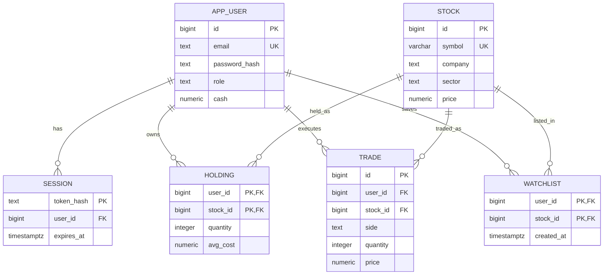

# Investor core: design and integration contract

## Problem and scope
A learner needs a safe way to inspect fictional stock prices and understand how consistent database transactions affect a portfolio. This part supports an investor's accounts, paper trades and watchlist; it is not a real exchange or matching engine.

## Entities and relationships

- `app_user`: `id` primary key; unique lower-case `email`; `password_hash`; `role` (`investor` or `admin`); nonnegative `cash`; `created_at`.
- `session`: `token_hash` primary key, `user_id` foreign key to `app_user`, expiry. One user may have many sessions.
- `stock`: `id` primary key; unique uppercase `symbol`, `company`, `sector`, positive `price` and `updated_at`. A stock may have many holdings, trades and watchlist entries.
- `holding`: (`user_id`, `stock_id`) composite primary key and foreign keys; nonnegative `quantity` and `avg_cost`. A user may hold many stocks, and a stock may be held by many users.
- `trade`: `id` primary key, user and stock foreign keys, `side`, positive `quantity`, positive execution `price`, `executed_at`. One user and one stock have many trades.
- `watchlist`: (`user_id`, `stock_id`) composite primary key and foreign keys; `created_at`. Many-to-many between users and stocks.

`portfolio_view` joins holdings to stocks to calculate current value and unrealized profit/loss. Indexes support recent trade lookup and session expiry. See `sql/schema.sql` for exact types, defaults and constraints. The user account role is present for integration, but admin endpoints are not included in this part.

## Architecture and trade consistency

Browser → Next.js route handlers → PostgreSQL. `execute_paper_trade` locks the user's account, reads the stock with a share lock, then locks the holding. A buy checks cash and calculates weighted average cost; a sell checks shares and preserves average cost unless the position is closed. The function updates cash, holdings and trade history within a single SQL statement. A raised error rolls back the statement, including a newly inserted holding. Every trade executes at the stored fictional price; there is no order book or matching engine. Portfolio P&L is unrealized and excludes fees and taxes.

## Integration contract for the other part

- Shared stock identity: `stock.id` is a PostgreSQL bigint primary key; `symbol` is unique. Research notes should reference `stock.id` with a foreign key.
- Auth cookie: `sl_session` is a random opaque token; `session.token_hash` contains its SHA-256 hash, never the plaintext token. The session join must check expiry, and protected actions must check `app_user.role` on the server.
- Public sign-up always creates `investor`. This part does not seed or provision an admin; admin provisioning should be added securely by the team before admin functionality is used. Do not expose a public role-selection field.
- Keep schemas and migrations compatible. Coordinate shared route/UI modifications rather than overwriting one another. The second database paradigm, research features, price auditing and admin UI remain future work for the other issue.

## Example API

`POST /api/auth/register`, `POST /api/auth/login`, `POST /api/auth/logout`, `GET /api/me`, `GET /api/stocks`, `GET /api/portfolio`, `GET /api/trades`, and `GET/POST/DELETE /api/watchlist`, `POST /api/trade`. Mutating endpoints require a same-origin `Origin` header. Portfolio, trade and watchlist queries filter by the authenticated user on the server. Watchlist mutations use `{ "stockId": 1 }`; trades use `{ "stockId": 1, "side": "BUY", "quantity": 2 }`.

## Evaluation notes

Show the schema and relationships; explain primary/foreign keys, checks, the portfolio view, transaction function and indexes; demonstrate INSERT, UPDATE, SELECT, DELETE via registration/trade/watchlist; show JOIN, GROUP BY, HAVING, ORDER BY, aggregates and a subquery in `sql/queries.sql`; then run the tests and show a failed trade leaves state unchanged. This is only one portion of the full project and needs the remaining work and project report before final evaluation.

## ER diagram

