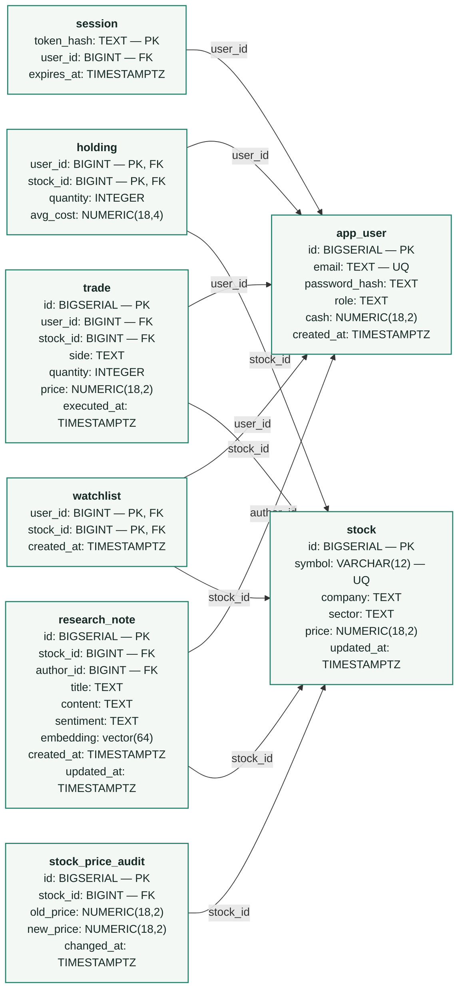

# StockLens — relational schema

This diagram converts the existing [ER diagram](RESEARCH_ADMIN_DESIGN.md#3-complete-system-er-diagram) into the tables actually defined in [`sql/schema.sql`](../sql/schema.sql). It shows columns, data types, primary keys and foreign keys; the constraints and delete rules are listed below.

**Legend:** PK = primary key · FK = foreign key · UQ = unique. Arrows point from a foreign key to the primary key it references. A composite primary key contains both marked columns.

## Relational notation

- **app_user**(**id**, email UQ, password_hash, role, cash, created_at)
- **session**(**token_hash**, user_id FK → app_user.id, expires_at)
- **stock**(**id**, symbol UQ, company, sector, price, updated_at)
- **holding**(**user_id** FK → app_user.id, **stock_id** FK → stock.id, quantity, avg_cost); composite PK = (user_id, stock_id)
- **trade**(**id**, user_id FK → app_user.id, stock_id FK → stock.id, side, quantity, price, executed_at)
- **watchlist**(**user_id** FK → app_user.id, **stock_id** FK → stock.id, created_at); composite PK = (user_id, stock_id)
- **stock_price_audit**(**id**, stock_id FK → stock.id, old_price, new_price, changed_at)
- **research_note**(**id**, stock_id FK → stock.id, author_id FK → app_user.id, title, content, sentiment, embedding, created_at, updated_at)

## Relationships and delete rules

Each FK points to one existing parent; a parent can have many rows in the referencing table. `holding` and `watchlist` connect users and stocks as many-to-many relationships, with at most one row per user–stock pair.

| Child foreign key | Parent | ON DELETE behavior |
|---|---|---|
| session.user_id | app_user.id | CASCADE |
| holding.user_id | app_user.id | CASCADE |
| holding.stock_id | stock.id | NO ACTION (default) |
| trade.user_id | app_user.id | NO ACTION (default) |
| trade.stock_id | stock.id | NO ACTION (default) |
| watchlist.user_id | app_user.id | CASCADE |
| watchlist.stock_id | stock.id | CASCADE |
| stock_price_audit.stock_id | stock.id | CASCADE |
| research_note.stock_id | stock.id | CASCADE |
| research_note.author_id | app_user.id | CASCADE |

## Constraints and defaults

All columns are `NOT NULL`. Primary keys are unique and not null. In addition:

| Table | Key checks and defaults |
|---|---|
| app_user | email is unique, lowercase and 3–254 characters; role is `investor` or `admin`; cash ≥ 0, default 100000.00; created_at defaults to now(). |
| session | token_hash is the PK; expires_at must be supplied. |
| stock | symbol is unique and 1–12 uppercase letters/digits; price > 0; updated_at defaults to now(). |
| holding | Composite PK; quantity ≥ 0, default 0; avg_cost ≥ 0, default 0. |
| trade | side is BUY or SELL; quantity > 0 and price > 0; executed_at defaults to now(). |
| watchlist | Composite PK; created_at defaults to now(). |
| stock_price_audit | old_price > 0 and new_price > 0; changed_at defaults to now(). |
| research_note | Trimmed title length 3–120; trimmed content length 10–5000; sentiment is BULLISH, BEARISH or NEUTRAL; embedding is a non-null 64-dimensional pgvector; created_at and updated_at default to now(). |

`BIGSERIAL` IDs are automatically generated. `portfolio_view` is a derived SQL view, not a separate base table. The research embedding also has an HNSW cosine index; see the SQL file for all indexes, the price-audit trigger and the paper-trade function.
