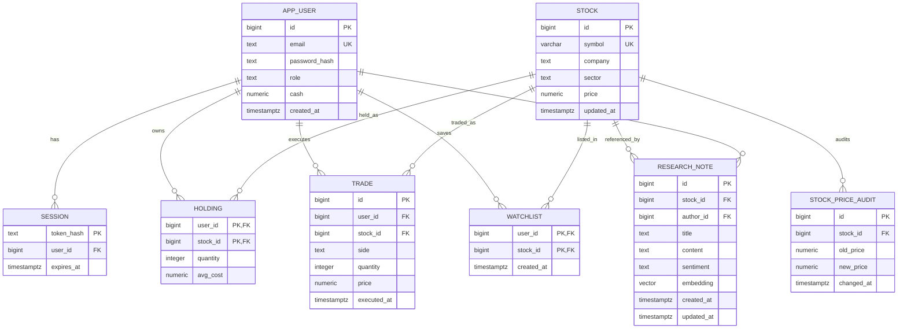

# StockLens: Simulated Paper Market Intelligence & Trading Platform
## DBMS Mini Project Final Report (UE24CS351A)

**Institution:** PES University · Department of Computer Science and Engineering  
**Course:** Database Management Systems (UE24CS351A) · Section C  
**Project Title:** StockLens — Paper Market Intelligence & Trading Lab  
**Team Members:**  
- **Debaditya Chakrabarti** (`PES1UG24CS140`) — Part 1: Investor Core & Relational Trading Core  
- **Dhadhal Rudra** (`PES1UG24CS146`) — Part 2: Vector Intelligence, Admin Controls & Price Audit Triggers  
**Repository:** [https://github.com/Debaditya-1729/stocklens-dbms-project](https://github.com/Debaditya-1729/stocklens-dbms-project)  

---

## 1. Executive Summary & Abstract

Modern financial market applications must manage two fundamentally different types of data:
1. **Strictly Structured Relational Data:** User account balances, cash ledgers, share holdings, order execution records, and watchlist items requiring strict **ACID transactional integrity** to prevent balance corruption, double-spending, or negative asset balances.
2. **Unstructured Qualitative Data:** Financial news, earnings transcripts, macroeconomic commentary, and analyst research reports containing sentiment and domain concepts that cannot be effectively queried with traditional keyword filters or exact SQL match operators.

**StockLens** bridges these two worlds within a single unified database architecture. It implements a fictional paper market intelligence lab utilizing **PostgreSQL 17** for the ACID relational core and the official **pgvector** extension for the vector intelligence paradigm. Investors trade simulated equities with instant atomic fills, track portfolio P&L in real time, and query analyst research using natural language semantic search. Administrators manage asset quotes with automated trigger-driven auditing and author research reports with auto-generated 64-dimensional embeddings.

---

## 2. Problem Statement & System Scope

Educational trading simulations often suffer from two major flaws:
- **Trivial Transaction Handling:** Naive applications execute multi-step database reads and writes in separate queries from application code, creating race conditions where concurrent requests cause duplicate execution, negative cash balances, or inconsistent average cost bases.
- **Disconnected Vector Databases:** Adding semantic vector search often leads to deploying a separate, external vector database (e.g. Pinecone, Chroma), introducing distributed transaction lag, dual-source-of-truth drift, and complex synchronization logic.

### Objectives:
1. Implement atomic paper trade execution entirely within a single PostgreSQL stored function using row-level locks (`SELECT ... FOR UPDATE` and `FOR SHARE`) to guarantee mathematical consistency.
2. Integrate vector embeddings natively inside PostgreSQL using `pgvector` to enable single-query relational JOINs between stock quotes and semantic cosine similarity rankings.
3. Enforce data non-repudiation using a PostgreSQL `BEFORE UPDATE` trigger that automatically logs old and new prices into an immutable audit table.
4. Provide role-based access control (RBAC) separating `investor` and `admin` capabilities with cryptographic password and session hashing.

---

## 3. Conceptual Database Design: ER Modeling

The conceptual model encompasses 8 entities capturing trading operations, user sessions, audit records, and semantic research notes.

### 3.1 Entity-Relationship Diagram (Mermaid)



### 3.2 Cardinalities & Structural Constraints:
- **`APP_USER` to `SESSION` ($1:M$):** One user can have multiple concurrent active sessions across devices. Deleting a user cascades and destroys all active sessions.
- **`APP_USER` to `HOLDING` ($1:M$) & `STOCK` to `HOLDING` ($1:M$):** Models a many-to-many relationship resolving investor asset allocations. Identified by composite primary key `(user_id, stock_id)`.
- **`APP_USER` to `TRADE` ($1:M$) & `STOCK` to `TRADE` ($1:M$):** Immutable historical order log.
- **`APP_USER` to `WATCHLIST` ($1:M$) & `STOCK` to `WATCHLIST` ($1:M$):** Many-to-many bookmark relationship.
- **`STOCK` to `STOCK_PRICE_AUDIT` ($1:M$):** Historical log of all quote modifications recorded by the database trigger.
- **`STOCK` to `RESEARCH_NOTE` ($1:M$) & `APP_USER` to `RESEARCH_NOTE` ($1:M$):** Qualitative intelligence authored by analysts referencing specific stock assets.

---

## 4. Logical Database Design & Normalization

### 4.1 Relational Schema Notation
- $\text{app\_user}(\underline{\text{id}}, \text{email}^{\text{UQ}}, \text{password\_hash}, \text{role}, \text{cash}, \text{created\_at})$
- $\text{session}(\underline{\text{token\_hash}}, \text{user\_id}^{\text{FK}}, \text{expires\_at})$
- $\text{stock}(\underline{\text{id}}, \text{symbol}^{\text{UQ}}, \text{company}, \text{sector}, \text{price}, \text{updated\_at})$
- $\text{holding}(\underline{\text{user\_id}}^{\text{FK}}, \underline{\text{stock\_id}}^{\text{FK}}, \text{quantity}, \text{avg\_cost})$
- $\text{trade}(\underline{\text{id}}, \text{user\_id}^{\text{FK}}, \text{stock\_id}^{\text{FK}}, \text{side}, \text{quantity}, \text{price}, \text{executed\_at})$
- $\text{watchlist}(\underline{\text{user\_id}}^{\text{FK}}, \underline{\text{stock\_id}}^{\text{FK}}, \text{created\_at})$
- $\text{stock\_price\_audit}(\underline{\text{id}}, \text{stock\_id}^{\text{FK}}, \text{old\_price}, \text{new\_price}, \text{changed\_at})$
- $\text{research\_note}(\underline{\text{id}}, \text{stock\_id}^{\text{FK}}, \text{author\_id}^{\text{FK}}, \text{title}, \text{content}, \text{sentiment}, \text{embedding}, \text{created\_at}, \text{updated\_at})$

### 4.2 Normalization Analysis (1NF, 2NF, 3NF, BCNF)
1. **First Normal Form (1NF):**
   - All attribute values are atomic (e.g. no comma-separated stock tickers or multi-value phone lists).
   - Each column contains values of a single well-defined type.
   - Primary keys uniquely identify every row.
2. **Second Normal Form (2NF):**
   - The relations with composite primary keys are `holding(user_id, stock_id)` and `watchlist(user_id, stock_id)`.
   - In `holding`, non-key attributes `quantity` and `avg_cost` depend strictly on the **entire composite key** (a specific user holding a specific stock), not on `user_id` or `stock_id` alone.
   - In `watchlist`, `created_at` represents when the user bookmarked that specific stock.
   - No partial functional dependencies exist; hence, all tables satisfy 2NF.
3. **Third Normal Form (3NF) & BCNF:**
   - A relation is in 3NF if for every functional dependency $X \to Y$, $X$ is a superkey or $Y$ is a prime attribute.
   - In `stock`, company and sector depend solely on the candidate keys `id` and `symbol`. No transitive dependencies ($A \to B \to C$) exist.
   - In `app_user`, role and cash depend strictly on `id` (or `email`).
   - In `research_note`, title, content, sentiment, and embedding depend solely on `id`.
   - In all relations, the left-hand side of every non-trivial functional dependency is a superkey. Therefore, the schema satisfies **Boyce-Codd Normal Form (BCNF)**.

---

## 5. Physical Database Implementation (DDL & Constraints)

The database schema is defined in [`sql/schema.sql`](../sql/schema.sql):

```sql
CREATE EXTENSION IF NOT EXISTS vector;

CREATE TABLE IF NOT EXISTS app_user (
 id BIGSERIAL PRIMARY KEY,
 email TEXT NOT NULL UNIQUE CHECK (email = lower(email) AND length(email) BETWEEN 3 AND 254),
 password_hash TEXT NOT NULL,
 role TEXT NOT NULL CHECK (role IN ('investor','admin')),
 cash NUMERIC(18,2) NOT NULL DEFAULT 100000.00 CHECK (cash >= 0),
 created_at TIMESTAMPTZ NOT NULL DEFAULT now()
);

CREATE TABLE IF NOT EXISTS session (
 token_hash TEXT PRIMARY KEY,
 user_id BIGINT NOT NULL REFERENCES app_user(id) ON DELETE CASCADE,
 expires_at TIMESTAMPTZ NOT NULL
);

CREATE TABLE IF NOT EXISTS stock (
 id BIGSERIAL PRIMARY KEY,
 symbol VARCHAR(12) NOT NULL UNIQUE CHECK (symbol ~ '^[A-Z0-9]{1,12}$'),
 company TEXT NOT NULL,
 sector TEXT NOT NULL,
 price NUMERIC(18,2) NOT NULL CHECK (price > 0),
 updated_at TIMESTAMPTZ NOT NULL DEFAULT now()
);

CREATE TABLE IF NOT EXISTS holding (
 user_id BIGINT NOT NULL REFERENCES app_user(id) ON DELETE CASCADE,
 stock_id BIGINT NOT NULL REFERENCES stock(id),
 quantity INTEGER NOT NULL DEFAULT 0 CHECK (quantity >= 0),
 avg_cost NUMERIC(18,4) NOT NULL DEFAULT 0 CHECK (avg_cost >= 0),
 PRIMARY KEY (user_id, stock_id)
);

CREATE TABLE IF NOT EXISTS trade (
 id BIGSERIAL PRIMARY KEY,
 user_id BIGINT NOT NULL REFERENCES app_user(id),
 stock_id BIGINT NOT NULL REFERENCES stock(id),
 side TEXT NOT NULL CHECK (side IN ('BUY','SELL')),
 quantity INTEGER NOT NULL CHECK (quantity > 0),
 price NUMERIC(18,2) NOT NULL CHECK (price > 0),
 executed_at TIMESTAMPTZ NOT NULL DEFAULT now()
);

CREATE TABLE IF NOT EXISTS watchlist (
 user_id BIGINT NOT NULL REFERENCES app_user(id) ON DELETE CASCADE,
 stock_id BIGINT NOT NULL REFERENCES stock(id) ON DELETE CASCADE,
 created_at TIMESTAMPTZ NOT NULL DEFAULT now(),
 PRIMARY KEY (user_id, stock_id)
);

CREATE TABLE IF NOT EXISTS stock_price_audit (
 id BIGSERIAL PRIMARY KEY,
 stock_id BIGINT NOT NULL REFERENCES stock(id) ON DELETE CASCADE,
 old_price NUMERIC(18,2) NOT NULL CHECK (old_price > 0),
 new_price NUMERIC(18,2) NOT NULL CHECK (new_price > 0),
 changed_at TIMESTAMPTZ NOT NULL DEFAULT now()
);

CREATE TABLE IF NOT EXISTS research_note (
 id BIGSERIAL PRIMARY KEY,
 stock_id BIGINT NOT NULL REFERENCES stock(id) ON DELETE CASCADE,
 author_id BIGINT NOT NULL REFERENCES app_user(id) ON DELETE CASCADE,
 title TEXT NOT NULL CHECK (length(trim(title)) BETWEEN 3 AND 120),
 content TEXT NOT NULL CHECK (length(trim(content)) BETWEEN 10 AND 5000),
 sentiment TEXT NOT NULL CHECK (sentiment IN ('BULLISH','BEARISH','NEUTRAL')),
 embedding vector(64) NOT NULL,
 created_at TIMESTAMPTZ NOT NULL DEFAULT now(),
 updated_at TIMESTAMPTZ NOT NULL DEFAULT now()
);
```

### 5.1 Indexes
```sql
CREATE INDEX IF NOT EXISTS idx_trade_user_time ON trade(user_id, executed_at DESC);
CREATE INDEX IF NOT EXISTS idx_session_expiry ON session(expires_at);
CREATE INDEX IF NOT EXISTS idx_audit_stock_time ON stock_price_audit(stock_id, changed_at DESC);
CREATE INDEX IF NOT EXISTS idx_research_stock ON research_note(stock_id);
CREATE INDEX IF NOT EXISTS idx_research_author ON research_note(author_id);
CREATE INDEX IF NOT EXISTS idx_research_embedding ON research_note USING hnsw (embedding vector_cosine_ops);
```

---

## 6. Advanced Database Programmability

### 6.1 Atomic Stored Procedure / Function: `execute_paper_trade`
To eliminate race conditions and double-spending, order execution is encapsulated in a single PL/pgSQL function executing inside an atomic transaction:

```sql
CREATE OR REPLACE FUNCTION execute_paper_trade(p_user BIGINT, p_stock BIGINT, p_side TEXT, p_qty INTEGER)
RETURNS BIGINT LANGUAGE plpgsql AS $$
DECLARE
 u app_user%ROWTYPE;
 s stock%ROWTYPE;
 h holding%ROWTYPE;
 t BIGINT;
 cost NUMERIC(18,2);
BEGIN
 IF p_side IS NULL OR p_side NOT IN ('BUY','SELL') OR p_qty IS NULL OR p_qty < 1 OR p_qty > 100000 THEN
   RAISE EXCEPTION 'Invalid trade';
 END IF;

 -- 1. Pessimistic exclusive row lock on user account
 SELECT * INTO u FROM app_user WHERE id = p_user FOR UPDATE;
 IF NOT FOUND THEN RAISE EXCEPTION 'Account not found'; END IF;

 -- 2. Shared row lock on stock quote
 SELECT * INTO s FROM stock WHERE id = p_stock FOR SHARE;
 IF NOT FOUND THEN RAISE EXCEPTION 'Stock not found'; END IF;

 -- 3. Ensure holding entry exists and acquire row lock
 INSERT INTO holding(user_id, stock_id) VALUES(p_user, p_stock) ON CONFLICT DO NOTHING;
 SELECT * INTO h FROM holding WHERE user_id = p_user AND stock_id = p_stock FOR UPDATE;

 cost := s.price * p_qty;

 IF p_side = 'BUY' THEN
   IF u.cash < cost THEN RAISE EXCEPTION 'Insufficient cash'; END IF;
   UPDATE app_user SET cash = cash - cost WHERE id = p_user;
   UPDATE holding 
   SET avg_cost = ((h.quantity * h.avg_cost) + cost) / (h.quantity + p_qty),
       quantity = h.quantity + p_qty 
   WHERE user_id = p_user AND stock_id = p_stock;
 ELSE
   IF h.quantity < p_qty THEN RAISE EXCEPTION 'Insufficient shares'; END IF;
   UPDATE app_user SET cash = cash + cost WHERE id = p_user;
   UPDATE holding 
   SET quantity = h.quantity - p_qty, 
       avg_cost = CASE WHEN h.quantity = p_qty THEN 0 ELSE h.avg_cost END 
   WHERE user_id = p_user AND stock_id = p_stock;
 END IF;

 INSERT INTO trade(user_id, stock_id, side, quantity, price) 
 VALUES(p_user, p_stock, p_side, p_qty, s.price) 
 RETURNING id INTO t;

 RETURN t;
END $$;
```

### 6.2 Price Change Audit Trigger & Function
```sql
CREATE OR REPLACE FUNCTION audit_stock_price_change()
RETURNS TRIGGER LANGUAGE plpgsql AS $$
BEGIN
 IF NEW.price <> OLD.price THEN
  INSERT INTO stock_price_audit(stock_id, old_price, new_price, changed_at)
  VALUES(OLD.id, OLD.price, NEW.price, now());
  NEW.updated_at := now();
 END IF;
 RETURN NEW;
END;
$$;

DROP TRIGGER IF EXISTS trg_stock_price_change ON stock;
CREATE TRIGGER trg_stock_price_change
BEFORE UPDATE ON stock
FOR EACH ROW
EXECUTE FUNCTION audit_stock_price_change();
```

### 6.3 Relational View: `portfolio_view`
```sql
CREATE OR REPLACE VIEW portfolio_view AS
 SELECT h.user_id, s.id AS stock_id, s.symbol, s.company, s.sector, h.quantity, h.avg_cost, s.price,
 (h.quantity * s.price)::numeric(18,2) AS market_value,
 (h.quantity * (s.price - h.avg_cost))::numeric(18,2) AS unrealized_pl
 FROM holding h JOIN stock s ON s.id = h.stock_id WHERE h.quantity > 0;
```

---

## 7. Vector Database Intelligence & pgvector Embedding Engine

### 7.1 Deterministic Embedding Architecture (`lib/vector.mjs`)
The vector engine maps natural language financial reports and user queries into a 64-dimensional Euclidean space $\mathbb{R}^{64}$:
1. **Domain Concept Projections (Dimensions 0–11):** 12 financial semantic clusters (`tech`, `banking`, `energy`, `automotive`, `healthcare`, `utilities`, `growth`, `profit`, `risk`, `bullish`, `bearish`, `governance`). Tokens matching these domain anchors project dense semantic signal into designated dimensions.
2. **Signed Term & Bigram Feature Hashing (Dimensions 12–63):** Arbitrary unigrams and bigrams are hashed into the remaining 52 dimensions using signed FNV-1a hashing ($h \pmod{52}$ with sign determined by $h \ \& \ 1$).
3. **$L_2$ Unit Normalization:** The vector is divided by its Euclidean norm:
   $$\|v\|_2 = \sqrt{\sum_{i=0}^{63} v_i^2} = 1.0$$

### 7.2 Cosine Similarity Mathematical Derivation
PostgreSQL pgvector's `<=>` operator computes cosine distance:
$$d_{\cos}(u, v) = 1 - \frac{u \cdot v}{\|u\|_2 \|v\|_2}$$
Because all stored and query vectors are normalized to unit length ($\|u\|_2 = \|v\|_2 = 1$), cosine distance simplifies to:
$$d_{\cos}(u, v) = 1 - (u \cdot v)$$
Cosine similarity is therefore derived directly as:
$$\text{Similarity}(u, v) = 1 - d_{\cos}(u, v) = u \cdot v$$
Queries run:
```sql
SELECT r.id, s.symbol, s.company, r.title, r.sentiment,
       ROUND((1 - (r.embedding <=> $1::vector))::numeric, 4) AS similarity_score
FROM research_note r
JOIN stock s ON s.id = r.stock_id
ORDER BY r.embedding <=> $1::vector ASC
LIMIT 10;
```

---

## 8. Comprehensive SQL Query Catalogue

The query suite in [`sql/queries.sql`](../sql/queries.sql) covers all required SQL categories:

| Category | Purpose | Core SQL Construct |
|---|---|---|
| **View Join** | Live portfolio valuation | `SELECT * FROM portfolio_view WHERE user_id = 1` |
| **Multi-Table Join & Aggregation** | Active volume summary | `JOIN`, `GROUP BY`, `HAVING SUM(quantity) > 0`, `ORDER BY` |
| **Nested Subquery** | Stocks above average price | `WHERE price > (SELECT AVG(price) FROM stock)` |
| **Correlated Subquery** | Bullish stocks with active holders | `WHERE EXISTS (SELECT 1 FROM research_note ...)` |
| **Recursive CTE** | 5-step price projection simulation | `WITH RECURSIVE price_projection AS (...)` |
| **Window Function CTE** | Top-3 recent trades partitioned by user | `ROW_NUMBER() OVER (PARTITION BY user_id ORDER BY executed_at DESC)` |
| **Vector Similarity Search** | Semantic nearest-neighbor ranking | `ORDER BY r.embedding <=> $1::vector ASC` |
| **Trigger Audit Inspection** | Chronological price delta log | `JOIN stock_price_audit a JOIN stock s` |

---

## 9. Full-Stack Web Application & API Integration

- **Frontend:** Next.js 15 (React 19) client components in [`app/page.js`](../app/page.js) with dark/light theme support.
  - **Overview Tab:** Summary metrics (Portfolio Value, Cash, Unrealized P&L), live positions table, watchlist, recent order history.
  - **Market Tab:** Live quotes board with watchlist toggles and instant paper trading execution form.
  - **Research Desk:** Natural language semantic search bar, company filter, cosine match percentage badges, sentiment tags.
  - **Admin Portal (Role-Gated):** Quote updater, analyst note publisher, real-time trigger audit table, active notes manager.
- **Backend API:** Dynamic Route Handlers in [`app/api/[...path]/route.js`](../app/api/[...path]/route.js).
  - Parameterized SQL queries preventing SQL injection vulnerabilities.
  - Zod schema validation ensuring strict bounds checking.
  - Origin header checking preventing Cross-Site Request Forgery (CSRF).

---

## 10. Authentication & Role-Based Access Control (RBAC)

1. **Two Distinct System Roles:**
   - `investor`: Default self-registration role. Full access to paper trading, portfolio management, watchlist, and research search.
   - `admin`: Provisioned administrative role. Authorized to update stock quotes, publish research notes, and view the trigger audit trail.
2. **Cryptographic Protection:**
   - Passwords hashed with `bcryptjs` using 12 salt rounds (resistant to brute-force and dictionary attacks).
   - Sessions issue 32-byte cryptographically random hex tokens, stored in the database exclusively as **SHA-256 hashes** (`session.token_hash`).
   - Delivered via `httpOnly: true`, `sameSite: 'lax'` secure cookies, preventing session theft via Cross-Site Scripting (XSS).
3. **Database-Level Role Verification:**
   - Server route handlers join `session` to `app_user` verifying `u.role === 'admin'`. Non-admin sessions attempting admin mutations receive **`403 Forbidden`**.

---

## 11. Testing & Verification Results

The automated integration test suite in [`tests/database.test.mjs`](../tests/database.test.mjs) runs against an isolated PostgreSQL-compatible engine with the pgvector extension:

```powershell
npm test
```
```text
> stocklens@1.0.0 test
> node --test tests/*.test.mjs

✔ paper trades enforce consistency, validation and portfolio valuation (1162ms)
✔ price audit trigger records price changes accurately and rejects invalid updates (618ms)
✔ research notes and pgvector similarity search rank relevant market research (594ms)
✔ role integrity ensures distinct investor and admin capabilities (754ms)
ℹ tests 4
ℹ suites 0
ℹ pass 4
ℹ fail 0
```

Production build verification:
```powershell
npm run build
```
- Compiled successfully with 0 type errors or lint warnings. First load JS ~108 kB.

---

## 12. Contribution Breakdown & Division of Work

| Deliverable Area | Debaditya Chakrabarti (`PES1UG24CS140`) | Dhadhal Rudra (`PES1UG24CS146`) |
|---|---|---|
| **Relational Core** | Relational DDL (`app_user`, `stock`, `holding`, `trade`, `watchlist`), `portfolio_view` | Audit table DDL (`stock_price_audit`), `research_note` table DDL |
| **Stored Logic** | `execute_paper_trade` PL/pgSQL function with row-level locking & average cost math | `audit_stock_price_change()` trigger function & `trg_stock_price_change` trigger |
| **Vector Engine** | Auth foundations & session hashing | 64-d domain embedding engine (`lib/vector.mjs`), pgvector HNSW index, cosine similarity ranking |
| **API Endpoints** | Auth (`register`, `login`, `logout`), `portfolio`, `trade`, `watchlist` | Research search (`/api/research/search`), Admin controls (`/api/admin/price`, `/api/admin/audit`, `/api/admin/notes`) |
| **UI Components** | Investor Overview, Market Board, Instant Paper Fill form | Research Desk semantic search UI, Admin Portal, Live trigger audit log table |
| **Documentation** | `docs/INVESTOR_DESIGN.md` | `docs/RESEARCH_ADMIN_DESIGN.md`, `docs/DEMO_RUBRIC.md`, `docs/REPORT.md` |

---

## 13. Conclusion

StockLens successfully satisfies the **two-paradigm DBMS requirement** by unifying a high-concurrency relational transaction engine with a native vector search intelligence desk within PostgreSQL. By leveraging row-level locks, database triggers, HNSW vector indexing, and server-enforced role access controls, the project demonstrates how modern applications can achieve financial mathematical rigor alongside intelligent semantic retrieval in a single, robust database architecture.
