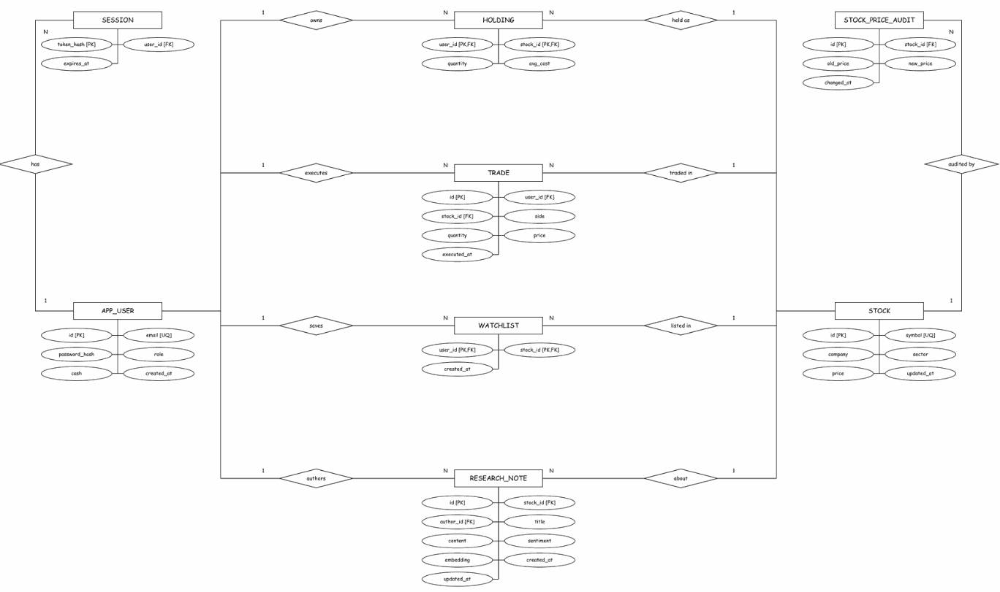
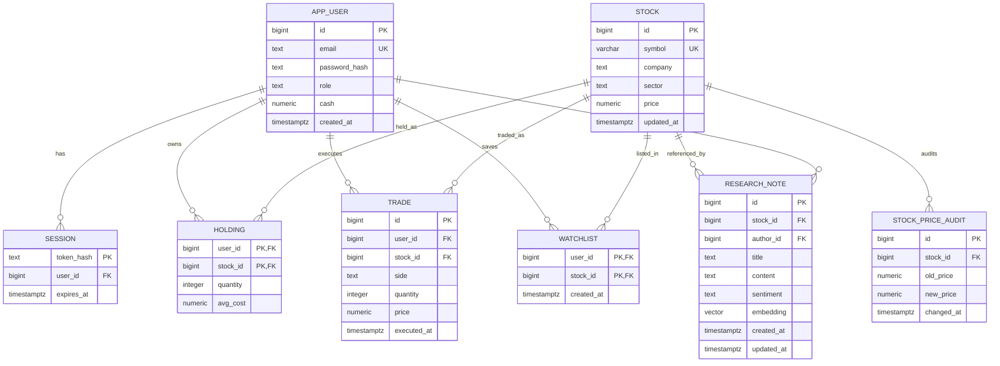

# Market intelligence, admin and vector search: design and integration

**UE24CS351A · Section C**  
Dhadhal Rudra (PES1UG24CS146) · Part 2 Core Architecture  
Coordinated with Debaditya Chakrabarti (PES1UG24CS140)

---

## 1. Problem and scope

A simulated market requires more than order execution: investors need qualitative intelligence (analyst commentary, sector trends, sentiment) to make informed paper trades, while administrators need secure tools to update fictional asset quotes and publish market research.

Part 2 introduces the **second database paradigm: pgvector semantic vector search**, alongside an automated **PostgreSQL trigger-based price audit engine** and **role-enforced administrative controls**.

---

## 2. Entities and relationships

- **`stock_price_audit`**: `id` bigserial primary key; `stock_id` foreign key referencing `stock(id)` on delete cascade; `old_price` and `new_price` (positive `numeric(18,2)`); `changed_at` timestamptz. Automatically populated by the PostgreSQL `trg_stock_price_change` trigger whenever a stock's price is updated.
- **`research_note`**: `id` bigserial primary key; `stock_id` foreign key referencing `stock(id)` on delete cascade; `author_id` foreign key referencing `app_user(id)` on delete cascade; `title` (3 to 120 characters); `content` (10 to 5000 characters); `sentiment` constrained to `('BULLISH','BEARISH','NEUTRAL')`; `embedding` (`vector(64)`); `created_at` and `updated_at` timestamptz.
- Indexed by:
  - `idx_audit_stock_time` on `stock_price_audit(stock_id, changed_at DESC)`
  - `idx_research_stock` on `research_note(stock_id)`
  - `idx_research_author` on `research_note(author_id)`
  - `idx_research_embedding` on `research_note USING hnsw (embedding vector_cosine_ops)`

---

## 3. Complete system ER diagram



Rectangles represent entities, diamonds represent relationships, and ovals represent attributes. **1** means exactly one parent; **N** means zero or many related records. **PK** = primary key, **FK** = foreign key, and **UQ** = unique. HOLDING and WATCHLIST have composite primary keys `(user_id, stock_id)`.

---

## 4. Vector embedding model & pgvector search

### 4.1 Embedding approach
The embedding engine (`lib/vector.mjs`) deterministically maps financial texts and search queries into a normalized 64-dimensional Euclidean vector space $\mathbb{R}^{64}$:
1. **Domain concept projection (Dimensions 0–11):** 12 financial and sector concept clusters (`tech`, `banking`, `energy`, `automotive`, `healthcare`, `utilities`, `growth`, `profit`, `risk`, `bullish`, `bearish`, `governance`). Tokens matching these domain anchors project dense semantic signal into designated dimensions.
2. **Term & bigram feature hashing (Dimensions 12–63):** Signed FNV-1a hashing trick maps arbitrary unigrams and bigrams across the remaining 52 dimensions, preserving subword and phrase specificity.
3. **L2-normalization:** Vectors are normalized to unit length ($\|v\|_2 = 1.0$), satisfying:
   $$\|v\|_2 = \sqrt{\sum_{i=0}^{63} v_i^2} = 1.0$$

### 4.2 Cosine distance and ranking
PostgreSQL pgvector's `<=>` operator computes cosine distance:
$$d_{\cos}(u, v) = 1 - \frac{u \cdot v}{\|u\|_2 \|v\|_2}$$
Because all stored and query vectors are unit-normalized ($\|u\|_2 = \|v\|_2 = 1$), cosine distance reduces to:
$$d_{\cos}(u, v) = 1 - (u \cdot v)$$
Cosine similarity is therefore derived directly as:
$$\text{sim}(u, v) = 1 - d_{\cos}(u, v) = u \cdot v$$
Queries use `ORDER BY r.embedding <=> $1::vector ASC` utilizing the **HNSW** (`vector_cosine_ops`) index for sub-millisecond retrieval.

### 4.3 Cosine ranking limitations
- **Lexical vs. semantic gap:** While domain projections capture core financial topics, bag-of-words and feature hashing cannot disambiguate complex syntactic negation (e.g., "not bullish" may have higher overlap with "bullish" than intended).
- **Fixed dimensionality:** 64 dimensions provides excellent separation for educational demonstration with zero external API dependencies, but production models (e.g., 384-d or 1536-d dense transformers) capture deeper contextual nuances at the expense of higher memory and inference overhead.
- **Cosine vs. Euclidean distance:** Cosine distance measures angular orientation (topic affinity) regardless of document length, which is optimal for text matching; Euclidean ($L_2$) distance would penalize length disparities between short queries and detailed research reports.

---

## 5. PostgreSQL price audit trigger

Automated auditing is enforced at the database level to ensure data integrity and non-repudiation:
```sql
CREATE OR REPLACE FUNCTION audit_stock_price_change()
RETURNS TRIGGER LANGUAGE plpgsql AS $$
BEGIN
 IF NEW.price <> OLD.price THEN
  INSERT INTO stock_price_audit(stock_id, old_price, new_price, changed_at)
  VALUES(OLD.id, OLD.price, NEW.price, now());
  NEW.updated_at := now();
 END IF;
 RETURN NEW;
END;
$$;

CREATE TRIGGER trg_stock_price_change
BEFORE UPDATE ON stock
FOR EACH ROW
EXECUTE FUNCTION audit_stock_price_change();
```
- Only price changes trigger an audit record; updates that leave `price` unchanged do not pollute the audit table.
- Invalid prices ($\le 0$) fail the `CHECK (price > 0)` constraint, automatically rolling back both the stock update and the trigger insertion.

---

## 6. Role-based access control (RBAC)

- **Authentication:** Sessions are verified against `session.token_hash` joining `app_user.role`.
- **Public sign-up:** Restricted strictly to `investor` accounts.
- **Admin routes:** All `/api/admin/*` endpoints strictly verify `user.role === 'admin'`. Unauthenticated or `investor` sessions receive `403 Forbidden`.
- **Demonstration accounts:**
  - Investor: `investor@stocklens.local` (password configured via `DEMO_INVESTOR_PASSWORD`)
  - Admin: `admin@stocklens.local` (password configured via `DEMO_ADMIN_PASSWORD` or `DEMO_INVESTOR_PASSWORD`)

---

## 7. API specification

| Method | Endpoint | Access | Purpose |
|---|---|---|---|
| `GET` | `/api/research/search?q=...&stockId=...` | Authenticated | Vector similarity search using pgvector `<=>` cosine distance |
| `POST` | `/api/admin/price` | Admin only | Update stock quote; triggers `stock_price_audit` insertion |
| `GET` | `/api/admin/audit` | Admin only | Fetch chronological price change audit history |
| `POST` | `/api/admin/notes` | Admin only | Publish research note with auto-computed 64-d vector embedding |
| `DELETE` | `/api/admin/notes` | Admin only | Delete research note |

---

## 8. Demonstration & Viva steps

1. **Verify automated audit trigger:**
   - Sign in as `admin@stocklens.local`.
   - Open **Admin Portal** → enter new price for Orbit Software (e.g., from ₹2,450 to ₹2,600).
   - Observe the live table in **Stock Price Audit Log** immediately populate with old quote, new quote, ₹ delta, and % jump.
2. **Demonstrate pgvector semantic search:**
   - Open **Research** tab.
   - Search for `"cloud AI recurring revenue"`: observe Orbit Software (`ORBT`) ranked #1 with high similarity score (> 80%).
   - Search for `"clean solar power grid"`: observe Sunvale Energy (`SUNV`) ranked #1.
   - Search for `"oncology clinical trial approval"`: observe Nova Healthcare (`NOVA`) ranked #1.
3. **Demonstrate access restrictions:**
   - Sign out and sign in as `investor@stocklens.local`.
   - Observe that the **Admin Portal** tab is completely hidden.
   - Attempting a direct `POST /api/admin/price` returns `403 Admin role required`.
4. **Demonstrate test suite:**
   - Run `npm test` to show all 4 test suites pass: trade consistency, trigger auditing, pgvector cosine search, and RBAC integrity.# Market intelligence, admin and vector search: design and integration

**UE24CS351A · Section C**  
Dhadhal Rudra (PES1UG24CS146) · Part 2 Core Architecture  
Coordinated with Debaditya Chakrabarti (PES1UG24CS140)

---

## 1. Problem and scope

A simulated market requires more than order execution: investors need qualitative intelligence (analyst commentary, sector trends, sentiment) to make informed paper trades, while administrators need secure tools to update fictional asset quotes and publish market research.

Part 2 introduces the **second database paradigm: pgvector semantic vector search**, alongside an automated **PostgreSQL trigger-based price audit engine** and **role-enforced administrative controls**.

---

## 2. Entities and relationships

- **`stock_price_audit`**: `id` bigserial primary key; `stock_id` foreign key referencing `stock(id)` on delete cascade; `old_price` and `new_price` (positive `numeric(18,2)`); `changed_at` timestamptz. Automatically populated by the PostgreSQL `trg_stock_price_change` trigger whenever a stock's price is updated.
- **`research_note`**: `id` bigserial primary key; `stock_id` foreign key referencing `stock(id)` on delete cascade; `author_id` foreign key referencing `app_user(id)` on delete cascade; `title` (3 to 120 characters); `content` (10 to 5000 characters); `sentiment` constrained to `('BULLISH','BEARISH','NEUTRAL')`; `embedding` (`vector(64)`); `created_at` and `updated_at` timestamptz.
- Indexed by:
  - `idx_audit_stock_time` on `stock_price_audit(stock_id, changed_at DESC)`
  - `idx_research_stock` on `research_note(stock_id)`
  - `idx_research_author` on `research_note(author_id)`
  - `idx_research_embedding` on `research_note USING hnsw (embedding vector_cosine_ops)`

---

## 3. Complete system ER diagram



---

## 4. Vector embedding model & pgvector search

### 4.1 Embedding approach
The embedding engine (`lib/vector.mjs`) deterministically maps financial texts and search queries into a normalized 64-dimensional Euclidean vector space $\mathbb{R}^{64}$:
1. **Domain concept projection (Dimensions 0–11):** 12 financial and sector concept clusters (`tech`, `banking`, `energy`, `automotive`, `healthcare`, `utilities`, `growth`, `profit`, `risk`, `bullish`, `bearish`, `governance`). Tokens matching these domain anchors project dense semantic signal into designated dimensions.
2. **Term & bigram feature hashing (Dimensions 12–63):** Signed FNV-1a hashing trick maps arbitrary unigrams and bigrams across the remaining 52 dimensions, preserving subword and phrase specificity.
3. **L2-normalization:** Vectors are normalized to unit length ($\|v\|_2 = 1.0$), satisfying:
   $$\|v\|_2 = \sqrt{\sum_{i=0}^{63} v_i^2} = 1.0$$

### 4.2 Cosine distance and ranking
PostgreSQL pgvector's `<=>` operator computes cosine distance:
$$d_{\cos}(u, v) = 1 - \frac{u \cdot v}{\|u\|_2 \|v\|_2}$$
Because all stored and query vectors are unit-normalized ($\|u\|_2 = \|v\|_2 = 1$), cosine distance reduces to:
$$d_{\cos}(u, v) = 1 - (u \cdot v)$$
Cosine similarity is therefore derived directly as:
$$\text{sim}(u, v) = 1 - d_{\cos}(u, v) = u \cdot v$$
Queries use `ORDER BY r.embedding <=> $1::vector ASC` utilizing the **HNSW** (`vector_cosine_ops`) index for sub-millisecond retrieval.

### 4.3 Cosine ranking limitations
- **Lexical vs. semantic gap:** While domain projections capture core financial topics, bag-of-words and feature hashing cannot disambiguate complex syntactic negation (e.g., "not bullish" may have higher overlap with "bullish" than intended).
- **Fixed dimensionality:** 64 dimensions provides excellent separation for educational demonstration with zero external API dependencies, but production models (e.g., 384-d or 1536-d dense transformers) capture deeper contextual nuances at the expense of higher memory and inference overhead.
- **Cosine vs. Euclidean distance:** Cosine distance measures angular orientation (topic affinity) regardless of document length, which is optimal for text matching; Euclidean ($L_2$) distance would penalize length disparities between short queries and detailed research reports.

---

## 5. PostgreSQL price audit trigger

Automated auditing is enforced at the database level to ensure data integrity and non-repudiation:
```sql
CREATE OR REPLACE FUNCTION audit_stock_price_change()
RETURNS TRIGGER LANGUAGE plpgsql AS $$
BEGIN
 IF NEW.price <> OLD.price THEN
  INSERT INTO stock_price_audit(stock_id, old_price, new_price, changed_at)
  VALUES(OLD.id, OLD.price, NEW.price, now());
  NEW.updated_at := now();
 END IF;
 RETURN NEW;
END;
$$;

CREATE TRIGGER trg_stock_price_change
BEFORE UPDATE ON stock
FOR EACH ROW
EXECUTE FUNCTION audit_stock_price_change();
```
- Only price changes trigger an audit record; updates that leave `price` unchanged do not pollute the audit table.
- Invalid prices ($\le 0$) fail the `CHECK (price > 0)` constraint, automatically rolling back both the stock update and the trigger insertion.

---

## 6. Role-based access control (RBAC)

- **Authentication:** Sessions are verified against `session.token_hash` joining `app_user.role`.
- **Public sign-up:** Restricted strictly to `investor` accounts.
- **Admin routes:** All `/api/admin/*` endpoints strictly verify `user.role === 'admin'`. Unauthenticated or `investor` sessions receive `403 Forbidden`.
- **Demonstration accounts:**
  - Investor: `investor@stocklens.local` (password configured via `DEMO_INVESTOR_PASSWORD`)
  - Admin: `admin@stocklens.local` (password configured via `DEMO_ADMIN_PASSWORD` or `DEMO_INVESTOR_PASSWORD`)

---

## 7. API specification

| Method | Endpoint | Access | Purpose |
|---|---|---|---|
| `GET` | `/api/research/search?q=...&stockId=...` | Authenticated | Vector similarity search using pgvector `<=>` cosine distance |
| `POST` | `/api/admin/price` | Admin only | Update stock quote; triggers `stock_price_audit` insertion |
| `GET` | `/api/admin/audit` | Admin only | Fetch chronological price change audit history |
| `POST` | `/api/admin/notes` | Admin only | Publish research note with auto-computed 64-d vector embedding |
| `DELETE` | `/api/admin/notes` | Admin only | Delete research note |

---

## 8. Demonstration & Viva steps

1. **Verify automated audit trigger:**
   - Sign in as `admin@stocklens.local`.
   - Open **Admin Portal** → enter new price for Orbit Software (e.g., from ₹2,450 to ₹2,600).
   - Observe the live table in **Stock Price Audit Log** immediately populate with old quote, new quote, ₹ delta, and % jump.
2. **Demonstrate pgvector semantic search:**
   - Open **Research** tab.
   - Search for `"cloud AI recurring revenue"`: observe Orbit Software (`ORBT`) ranked #1 with high similarity score (> 80%).
   - Search for `"clean solar power grid"`: observe Sunvale Energy (`SUNV`) ranked #1.
   - Search for `"oncology clinical trial approval"`: observe Nova Healthcare (`NOVA`) ranked #1.
3. **Demonstrate access restrictions:**
   - Sign out and sign in as `investor@stocklens.local`.
   - Observe that the **Admin Portal** tab is completely hidden.
   - Attempting a direct `POST /api/admin/price` returns `403 Admin role required`.
4. **Demonstrate test suite:**
   - Run `npm test` to show all 4 test suites pass: trade consistency, trigger auditing, pgvector cosine search, and RBAC integrity.
